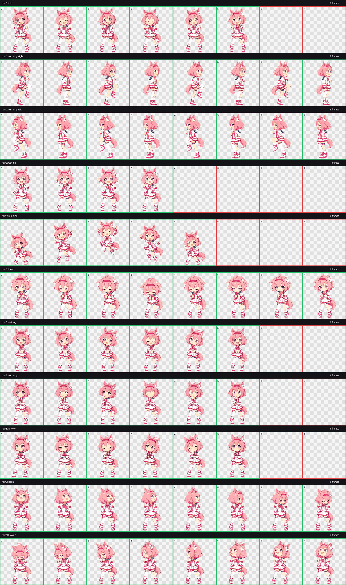
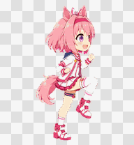
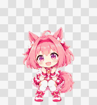
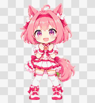
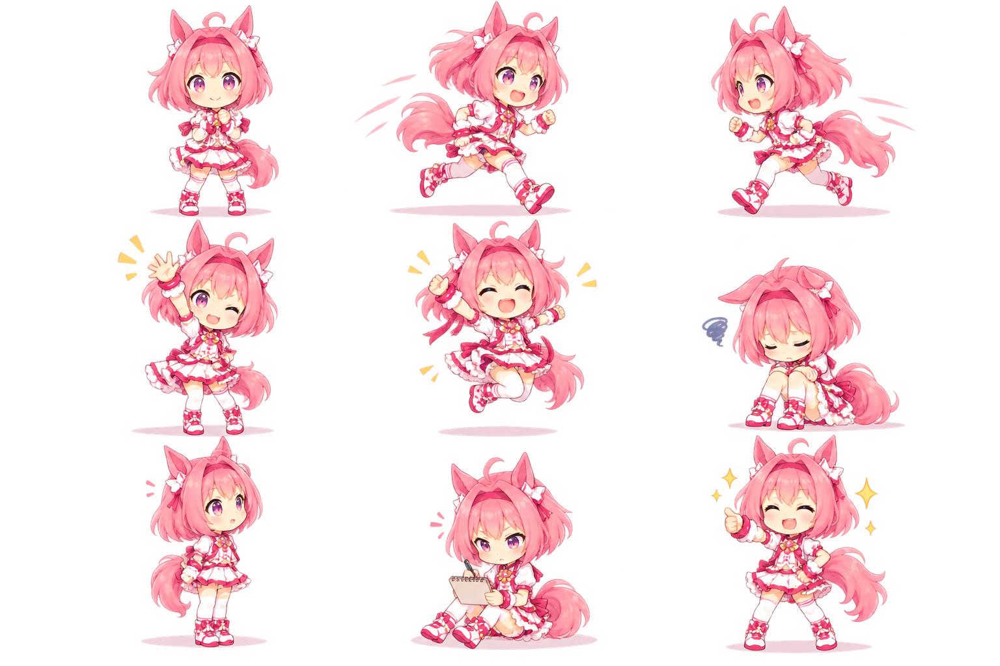

# Haru Urara · ChatGPT Pet

Proyecto reproducible para conservar, revisar y evolucionar la mascota personalizada **Haru Urara**: alegre, perseverante y expresiva en estilo chibi anime.



## Estado del activo

| Propiedad | Valor |
| --- | --- |
| ID estable | `pet_6abd41eef0f481919d149ed7592aeb99` |
| Formato | Sprite sheet v2, PNG transparente |
| Dimensiones | 1536 × 2288 px |
| Cuadrícula | 8 columnas × 11 filas |
| Celda | 192 × 208 px |
| Validación | Estructura aprobada |

El archivo canónico está en [`assets/sprites/haru-urara-spritesheet.png`](assets/sprites/haru-urara-spritesheet.png). Los frames, GIF y hojas de revisión son derivados reproducibles.

## Animation Lab

El visor de [`viewer/index.html`](viewer/index.html) permite:

- Reproducir cada estado de forma independiente.
- Avanzar cuadro por cuadro.
- Ajustar velocidad y escala.
- Revisar transparencia sobre cuatro fondos.
- Mostrar una línea de suelo para detectar vibraciones.
- Respetar la preferencia del sistema de movimiento reducido.

Para abrirlo sin problemas de rutas locales, inicia un servidor desde la raíz:

```powershell
python -m http.server 8000
```

Después visita `http://localhost:8000/viewer/`.

## Construcción reproducible

Requisitos:

```powershell
python -m pip install -r requirements.txt
```

Genera todos los derivados, actualiza metadatos y valida el atlas:

```powershell
python .\scripts\build.py
```

El wrapper `scripts/build.ps1` también está disponible. Si Python no está en `PATH`, define `PET_HARU_PYTHON` con la ruta de su ejecutable.

También puedes ejecutar pasos individuales:

```powershell
python .\scripts\generate_previews.py
python .\scripts\validate_pet.py --update-metadata
```

La validación comprueba dimensiones, celdas transparentes, frames vacíos o duplicados, estabilidad aproximada de la línea de suelo, continuidad del ciclo, tamaño y hash SHA-256.

## Estados

| Estado | Frames | Propósito |
| --- | ---: | --- |
| `idle` | 6 | Reposo vivo y calmado |
| `running-right` | 8 | Carrera hacia la derecha |
| `running-left` | 8 | Carrera hacia la izquierda |
| `waving` | 4 | Saludo alegre |
| `jumping` | 5 | Salto y regreso a la base |
| `failed` | 8 | Fallo y recuperación emocional |
| `waiting` | 6 | Espera de aprobación o ayuda |
| `running` | 6 | Trabajo y concentración |
| `review` | 6 | Revisión del resultado |
| `look-a` | 8 | Miradas de 0° a 157.5° |
| `look-b` | 8 | Miradas de 180° a 337.5° |







## Dirección artística

La referencia [`docs/concepts/animation-polish-v1.png`](docs/concepts/animation-polish-v1.png) propone siluetas más marcadas, poses diferenciadas y movimiento secundario para cabello, orejas, falda, cintas y cola. Es una guía conceptual: no reemplaza el atlas validado.



## Estructura

```text
.github/workflows/  Validación continua
assets/sprites/    Sprite sheet canónico
assets/frames/     Frames extraídos por estado
docs/              Metadatos, especificación y conceptos
previews/          GIF y hojas de revisión
qa/                Resultados de validación
scripts/           Construcción y herramientas reproducibles
viewer/            Laboratorio visual interactivo
```

## Flujo para una nueva versión

1. Crear una rama y conservar el atlas anterior mediante una etiqueta de versión.
2. Modificar solamente las filas necesarias, manteniendo tamaño y cuadrícula.
3. Ejecutar `scripts/build.ps1`.
4. Revisar cada animación en Animation Lab a velocidad normal y lenta.
5. Corregir saltos de línea de suelo, silueta y continuidad.
6. Confirmar que `qa/validation.json` no tenga errores.
7. Registrar el cambio en [`CHANGELOG.md`](CHANGELOG.md) antes de publicar.

Consulta [`docs/sprite-layout.md`](docs/sprite-layout.md) para la disposición exacta de las filas.
